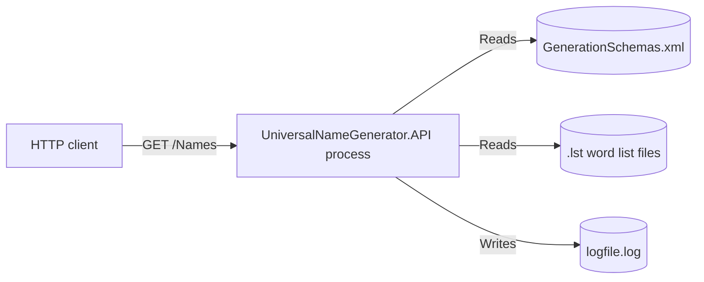
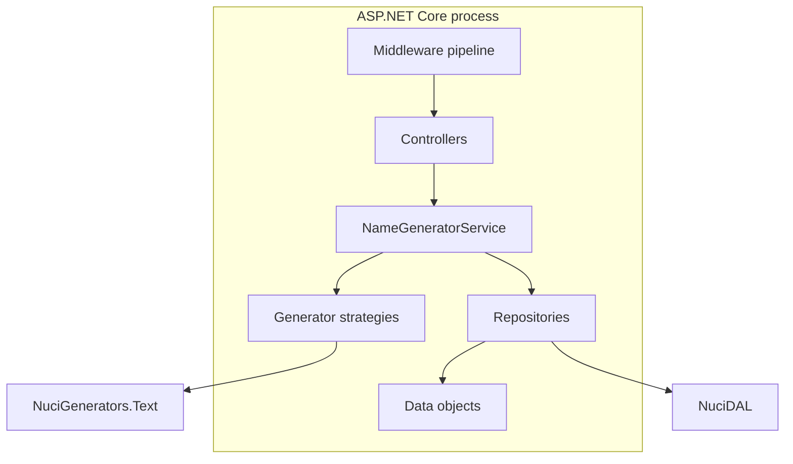
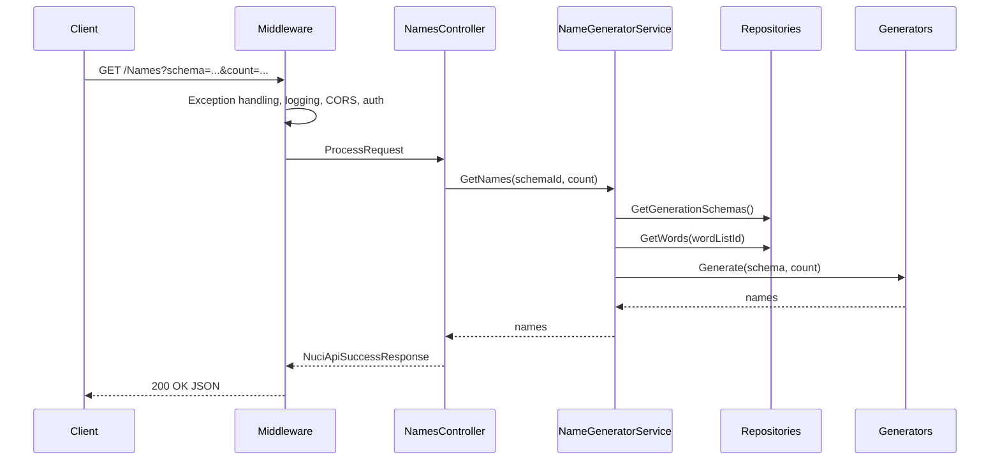
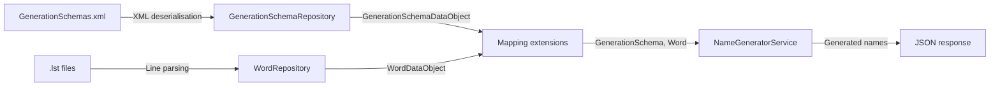
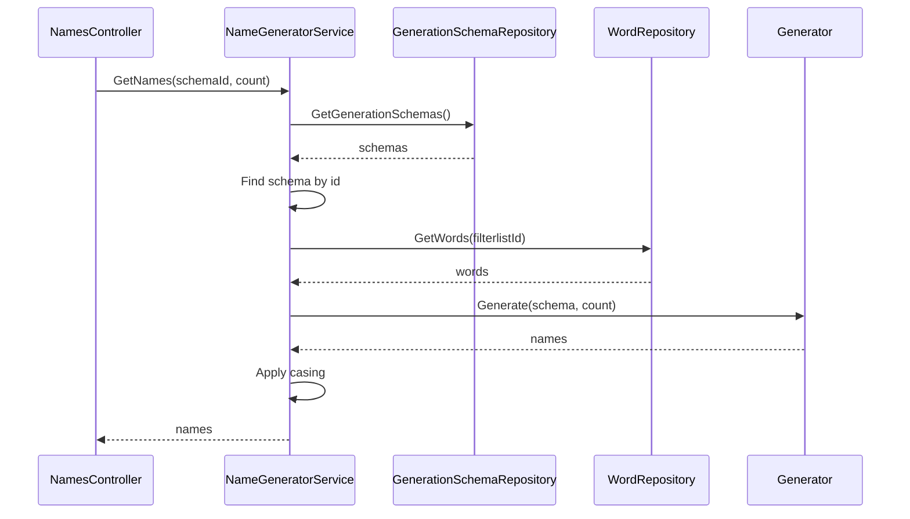
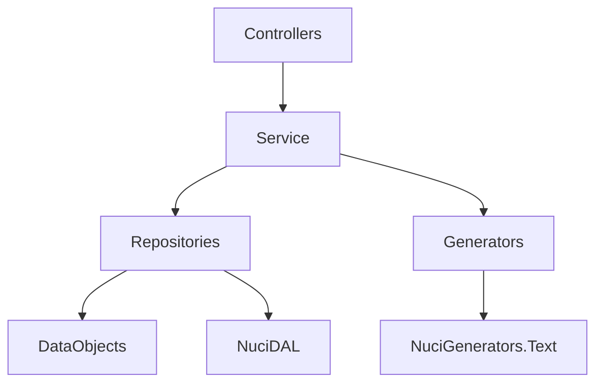

# Architecture

This document complements the root [ARCHITECTURE.md](../ARCHITECTURE.md) with a documentation-oriented view of the system. It does not replace the root document; it summarises the verified architecture and points to detailed component and flow documents.

## System boundary

The system is a single ASP.NET Core process exposing one authenticated HTTP endpoint. It reads generation schemas and word lists from the local filesystem and returns generated names as JSON.



The principal external boundaries are:

- **HTTP clients:** Send `GET /Names` with an API key. Receive JSON name arrays or error responses.
- **Filesystem:** Supplies `GenerationSchemas.xml` and `.lst` word lists. The API reads only; it never writes data files.
- **Log file:** Receives structured log output when `nuciLoggerSettings:isFileOutputEnabled` is true.

## Architectural style

Modular monolith with layered dependency direction: presentation (controllers) -> application (service) -> data access (repositories). The NuciAPI ecosystem supplies cross-cutting middleware, response envelopes, and logging.



The principal architecture boundaries are:

- **Presentation:** Controllers accept requests, delegate to the service, and return NuciAPI response envelopes. No generation logic.
- **Application:** `NameGeneratorService` interprets schema strings, dispatches to generator strategies, applies filter lists and casing.
- **Data access:** Repositories read XML and `.lst` files and return data objects. No business logic.
- **Cross-cutting:** NuciAPI middleware handles exceptions, logging, CORS, scanner protection, and authentication.

## Runtime process



The principal runtime sequence is:

1. Host builds and configures the pipeline at startup.
2. An authenticated request reaches `NamesController`.
3. The controller delegates to `NameGeneratorService.GetNames`.
4. The service resolves the schema, loads word lists, dispatches to the generator, applies filters and casing.
5. The response envelope returns to the client.

## Components

| Component | Responsibility | Principal Dependencies | Lifetime or Ownership |
|-----------|----------------|------------------------|-----------------------|
| `Program` | Host entry point | `Startup` | Process |
| `Startup` | Composition root | Configuration, NuciAPI | Process |
| `NamesController` | HTTP endpoint | `INameGeneratorService` | Scoped |
| `NameGeneratorService` | Schema interpretation and orchestration | Repositories, generators | Scoped |
| `RandomiserNameGenerator` | Randomiser strategy | `Word` service models | Transient per use |
| `RandomSelectorNameGenerator` | Random selector strategy | `Word` service models | Transient per use |
| `GenerationSchemaRepository` | XML schema reading | `DataStoreSettings` | Singleton |
| `WordRepository` | `.lst` word list reading | `DataStoreSettings` | Singleton |
| `NuciLogger` | Structured logging | `nuciLoggerSettings` | Singleton |

## Architectural areas

### Presentation

Paths:
- `UniversalNameGenerator.API/Controllers/`

Responsibilities:
- HTTP request binding and response shaping.
- Delegation to the application service.

Boundary rules:
- Controllers must not contain generation logic.
- Controllers depend on `INameGeneratorService`, not concrete implementations.

### Application

Paths:
- `UniversalNameGenerator.API/Service/`

Responsibilities:
- Schema string parsing.
- Generator dispatch.
- Filter list application.
- Word casing transformation.

Boundary rules:
- The service depends on repository interfaces and generator strategies.
- The service must not depend on controllers or middleware.

### Data access

Paths:
- `UniversalNameGenerator.API/DataAccess/`

Responsibilities:
- Reading `GenerationSchemas.xml`.
- Reading `.lst` word list files.
- Mapping data objects to service models.

Boundary rules:
- Data access must not depend on the service layer.
- Data objects are serialisation concerns, not domain logic.

### Cross-cutting

Paths:
- `UniversalNameGenerator.API/Logging/`
- `UniversalNameGenerator.API/Configuration/`
- `UniversalNameGenerator.API/ServiceCollectionExtensions.cs`

Responsibilities:
- Structured logging keys and operations.
- Configuration POCOs.
- DI registration.

Boundary rules:
- Cross-cutting components may be referenced by all layers.
- They must not reference controllers or the service.

## Data architecture



| Data or Store | Owner | Representation and Storage | Lifecycle or Consistency |
|---------------|-------|----------------------------|--------------------------|
| `GenerationSchemaDataObject` | `GenerationSchemaRepository` | XML element in `GenerationSchemas.xml` | Read at service construction; cached in memory |
| `WordDataObject` | `WordRepository` | `.lst` file with underscore-separated id and values | Read per word list load; cached by schema |
| `GenerationSchema` | `NameGeneratorService` | In-memory service model | Per-request or cached by schema identifier |
| `Word` | `NameGeneratorService` | In-memory service model | Per-request |

## Interfaces and integrations

| Interface or Integration | Direction | Contract | Owner | Failure Semantics |
|--------------------------|-----------|----------|-------|-------------------|
| `GET /Names` | Inbound | HTTP GET with `schema` and `count` query parameters | `NamesController` | Exception middleware translates failures to error responses |
| Filesystem reads | Outbound | `GenerationSchemas.xml`, `.lst` files | Repositories | Missing files surface as exceptions; no retry |
| NuciAPI middleware | Inbound | Exception handling, logging, CORS, auth | `Startup` | Failures terminate the request with an error response |

## Key processes

### Name generation



Ordering: schema resolution precedes word list loading. Filter lists apply before generation. Casing applies after generation. Failure at any step propagates to the exception middleware.

## Cross-cutting concerns

### Security and privacy

API key authorisation via the `Authorization` header. Constant-time comparison through `NuciSecurity.HMAC`. No personal data is collected. See [Security](./security.md).

### Error handling

NuciAPI exception handling middleware translates exceptions to structured error responses. See [Error handling](./error-handling.md).

### Observability

NuciLog structured logging with operation names and info keys. File sink controlled by configuration. See [Logging](./logging.md).

### Configuration

`appsettings.json` with environment variable overrides. See [Configuration](./configuration.md).

### Concurrency and resource use

Scoped service per request. Generator caches are per-service-instance. No background tasks. See [Concurrency and scheduling](./concurrency-and-scheduling.md).

## Dependency direction and rules



The principal dependency rules are:

- Controllers depend on the service interface, not the implementation.
- The service depends on repositories and generator strategies.
- Repositories depend on data objects and configuration.
- Data access must not depend on the service or controllers.
- Test projects depend on production projects; the reverse is prohibited.

## External dependencies

| Dependency | Responsibility | Integration Boundary | Architectural Consequence |
|------------|----------------|----------------------|---------------------------|
| `NuciAPI` | Response envelopes and base types | Controller return types | Shapes all HTTP responses |
| `NuciAPI.Controllers` | Controller base and request processing | `NamesController` | Enforces `ProcessRequest` pattern |
| `NuciAPI.Middleware.*` | Exception handling, logging, CORS, scanner protection, authentication | `Startup` pipeline | Cross-cutting concerns are externalised |
| `NuciDAL` | XML repository base | `GenerationSchemaRepository` | XML deserialisation is standardised |
| `NuciGenerators.Text` | Random, randomiser, random-selector, Markov generators | `NameGeneratorService` | Generation algorithms are externalised |
| `NuciLog` | Structured logging | `ServiceCollectionExtensions` | Logging is framework-supplied |
| `NuciSecurity.HMAC` | Constant-time comparison | API key validation | Timing-attack mitigation |

See [Dependencies](./dependencies.md) for the full package list.

## Deployment and operations

| Concern | Current Design | Architectural Consequence |
|---------|----------------|---------------------------|
| Process topology | Single ASP.NET Core process | No distributed coordination |
| State | File-backed, read-only | No migrations or schema evolution at runtime |
| Scaling | Horizontal via multiple instances | Each instance reads the same files |
| Availability | Process lifetime | Restart required for data file changes |
| Recovery | Restart | In-memory caches rebuild on startup |

See [Build and deployment](./build-and-deployment.md).

## Compatibility contracts

| Contract | Owner | Invariant | Verification | Change Policy |
|----------|-------|-----------|--------------|---------------|
| `GET /Names` request shape | `NamesController` | `schema` string, `count` int 1-100000 | Integration tests | Additive only |
| `GET /Names` response shape | `NamesController` | NuciAPI success envelope with `names` array | Integration tests | Additive only |
| Schema string format | `NameGeneratorService` | `{command,params}` delimiters | Unit tests | Backward-compatible command additions |
| `.lst` file format | `WordRepository` | Underscore-separated id and values, `#` comments | Unit tests | Stable |
| `GenerationSchemas.xml` format | `GenerationSchemaRepository` | XML-serialised `GenerationSchemaDataObject` | Unit tests | Stable |

## Testing and verification

The repository verifies architecture through three test projects. See [Testing](./testing.md).

Execute the principal automated verification with:

```bash
dotnet test
```

## Design constraints

- **File-backed data:** No database. Operators manage data files directly. Consequence: no runtime schema evolution.
- **Single endpoint:** The API exposes one operation. Consequence: simplicity over feature breadth.
- **Nuci ecosystem:** Cross-cutting concerns are supplied by Nuci packages. Consequence: framework coupling in exchange for standardised behaviour.
- **In-memory caching:** Generators are cached per service instance. Consequence: memory use scales with distinct schemas per process.

## Extension points

### Adding a generator command

1. Implement the generator strategy or use an existing `NuciGenerators.Text` generator.
2. Add the command name to the dispatch switch in `NameGeneratorService`.
3. Add unit tests for the new command.
4. Update the schema documentation.

The command name must be a lowercase ordinal match. Parameters follow the established `{command,param1,param2,...}` format.

### Adding a new endpoint

1. Define the controller interface and implementation.
2. Register the controller in the API scanner.
3. Add integration tests for routing, authorisation, and behaviour.
4. Update the API reference documentation.

The endpoint must follow the NuciAPI `ProcessRequest` pattern and return NuciAPI response envelopes.

## Evolution and migration

### Current state

Single endpoint, four generator commands, file-backed data, no database.

### Target state

No documented target state. The root `ROADMAP.md` (if present) defines planned work.

### Transition

No active migration. Changes are additive: new generator commands, new endpoints, or new word list formats.

Compatibility requirements:

- Existing schema strings must continue to parse.
- Existing `.lst` files must continue to load.
- The `GET /Names` contract must remain backward-compatible.

## Architecture decisions

| Decision | Rationale | Consequence | Record |
|----------|-----------|-------------|--------|
| Modular monolith | Simple deployment, no distributed coordination | Single process, horizontal scaling only | Documented here |
| File-backed data | No database operational burden | Operators manage data files | Documented here |
| NuciAPI ecosystem | Standardised middleware, logging, and responses | Framework coupling | Documented here |
| Schema string DSL | Compact schema representation | Custom parsing logic in service | Documented here |

## Source map

| Area | Path |
|------|------|
| Presentation | `UniversalNameGenerator.API/Controllers/` |
| Application | `UniversalNameGenerator.API/Service/` |
| Data access | `UniversalNameGenerator.API/DataAccess/` |
| Cross-cutting | `UniversalNameGenerator.API/Logging/`, `UniversalNameGenerator.API/Configuration/` |
| Composition | `UniversalNameGenerator.API/Startup.cs`, `UniversalNameGenerator.API/Program.cs` |
| Unit tests | `UniversalNameGenerator.API.UnitTests/` |
| Integration tests | `UniversalNameGenerator.API.IntegrationTests/` |
| Architecture tests | `UniversalNameGenerator.API.ArchitectureTests/` |

## Related documentation

- [ARCHITECTURE.md](../ARCHITECTURE.md) - Root architecture document with the canonical current-state description.
- [Components](./components/host-and-composition.md) - Detailed component documentation.
- [Flows](./flows/startup-and-composition.md) - Detailed runtime flows.
- [Data model](./data-model.md) - Data structures and file formats.
