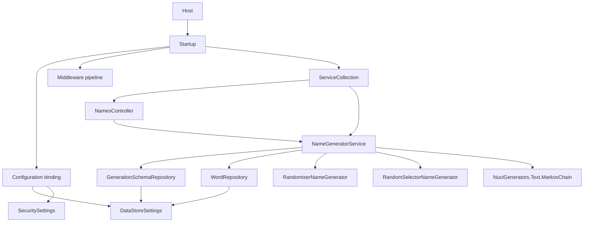

# Host and composition

This document covers the process entry point, the composition root, the middleware pipeline, and dependency injection.

## Program

`UniversalNameGenerator.API/Program.cs` is the process entry point. It builds the host and runs it.

```csharp
public class Program
{
    public static void Main(string[] args)
    {
        CreateHostBuilder(args).Build().Run();
    }

    public static IHostBuilder CreateHostBuilder(string[] args) =>
        Host.CreateDefaultBuilder(args)
            .ConfigureWebHostDefaults(webBuilder =>
            {
                webBuilder.UseStartup<Startup>();
            });
}
```

Responsibilities:

- Build the generic host with default configuration, logging, and DI.
- Configure the web host to use `Startup`.
- Run the host until shutdown.

## Startup

`UniversalNameGenerator.API/Startup.cs` is the composition root. It implements `IStartup` for testability.

### Configuration binding

`Startup` binds configuration sections to POCOs:

- `dataStoreSettings` -> `DataStoreSettings`
- `securitySettings` -> `SecuritySettings`

### Service registration

`AddCustomServices` registers:

| Service | Lifetime | Implementation |
|---------|----------|----------------|
| `DataStoreSettings` | Singleton | Bound from configuration |
| `SecuritySettings` | Singleton | Bound from configuration |
| `INameGeneratorService` | Scoped | `NameGeneratorService` |
| `ILogger` | Singleton | `NuciLogger` |

Repositories are registered by the NuciDAL scanner or explicitly, depending on the NuciAPI version.

### Middleware pipeline

`Configure` orders the middleware:

1. Exception handling (NuciAPI)
2. Scanner protection (NuciAPI)
3. Request logging (NuciAPI)
4. CORS (NuciAPI)
5. HTTPS redirection
6. Static files
7. Routing
8. Authentication (API key)
9. Authorization
10. Endpoints

Ordering matters: exception handling must be first to catch downstream failures. Authentication must precede endpoint dispatch so unauthenticated requests never reach controllers.

## IStartup

`IStartup.cs` exposes the `Startup` configuration through an interface. This allows integration tests to compose a test host with the same pipeline.

## ServiceCollectionExtensions

`ServiceCollectionExtensions.cs` contains extension methods that encapsulate registration logic:

- `AddConfigurations` - Binds settings POCOs.
- `AddNuciApiScannerProtection` - Adds scanner protection.
- `AddCustomServices` - Registers application services.

These methods keep `Startup.ConfigureServices` readable and testable.

## Dependency injection graph



## Lifetime implications

- **Singleton settings:** Configuration is read once at startup. Changing `appsettings.json` requires a restart.
- **Scoped service:** `NameGeneratorService` is created per request. Its generator cache lives for the request duration.
- **Singleton logger:** `NuciLogger` is shared across requests.

See [Concurrency and scheduling](../concurrency-and-scheduling.md) for thread-safety implications.
