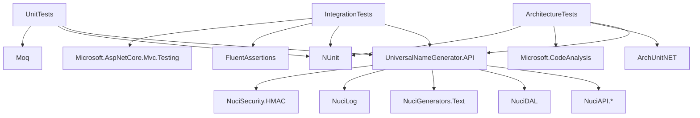

# Dependencies

This document lists the external and internal dependencies of the Universal Name Generator API.

## NuGet packages (UniversalNameGenerator.API)

| Package | Version | Purpose |
|---------|---------|---------|
| `NuciAPI` | Latest | Response envelopes, base types, controller base. |
| `NuciAPI.Controllers` | Latest | `ProcessRequest` pattern, request binding. |
| `NuciAPI.Middleware.ExceptionHandling` | Latest | Exception to error response translation. |
| `NuciAPI.Middleware.ScannerProtection` | Latest | Scanner user agent blocking. |
| `NuciAPI.Middleware.RequestLogging` | Latest | Structured request/response logging. |
| `NuciAPI.Middleware.Cors` | Latest | CORS policy. |
| `NuciDAL` | Latest | XML repository base class. |
| `NuciGenerators.Text` | Latest | Random, randomiser, random-selector, Markov generators. |
| `NuciLog` | Latest | Structured logging framework. |
| `NuciSecurity.HMAC` | Latest | Constant-time comparison for API key. |
| `Microsoft.AspNetCore.OpenApi` | Latest | OpenAPI support (if used). |

Package versions are managed in `UniversalNameGenerator.API.csproj` and updated via Dependabot or manual updates.

## NuGet packages (Test projects)

### UniversalNameGenerator.API.UnitTests

| Package | Purpose |
|---------|---------|
| `NUnit` | Test framework. |
| `Moq` | Mocking framework. |
| `NuciAPI` | Response envelope types for assertions. |

### UniversalNameGenerator.API.IntegrationTests

| Package | Purpose |
|---------|---------|
| `NUnit` | Test framework. |
| `FluentAssertions` | Fluent assertions. |
| `Microsoft.AspNetCore.Mvc.Testing` | `WebApplicationFactory` for integration testing. |
| `NuciAPI` | Response envelope types. |

### UniversalNameGenerator.API.ArchitectureTests

| Package | Purpose |
|---------|---------|
| `ArchUnitNET` | Architecture rules. |
| `Microsoft.CodeAnalysis.CSharp` | Roslyn source analysis. |
| `NUnit` | Test framework. |

## Internal dependencies

| From | To | Type |
|------|-----|------|
| `Controllers` | `Service` | Interface (`INameGeneratorService`) |
| `Service` | `DataAccess` | Interfaces (`IGenerationSchemaRepository`, `IWordRepository`) |
| `Service` | `DataAccess` | Data objects (`GenerationSchemaDataObject`, `WordDataObject`) |
| `Service` | `Service.NameGenerators` | Concrete generators |
| `DataAccess` | `NuciDAL` | Base class (`XmlRepository`) |
| `Service` | `NuciGenerators.Text` | Generator implementations |

## Dependency graph

## Version management

- All Nuci* packages use the same version (aligned releases).
- .NET version: `10.0` (target framework `net10.0`).
- Update command: `dotnet add package <package> --version <version>`.

## Vulnerability scanning

The security workflow runs `dotnet list package --vulnerable --include-transitive` on every push and weekly.

See [Build and deployment](../build-and-deployment.md).