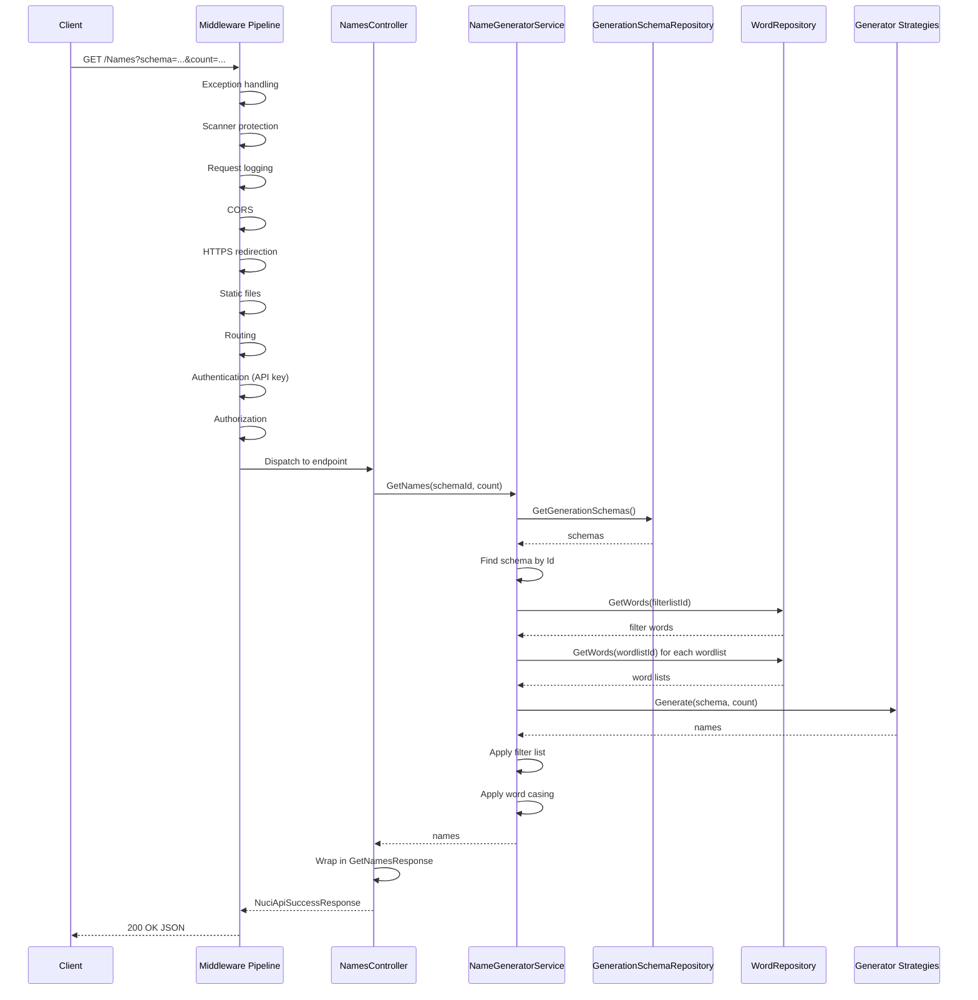

# Name generation request

This document describes the end-to-end flow of an authenticated `GET /Names` request from HTTP receipt to JSON response.

## Flow overview



## Step-by-step

### 1. HTTP request receipt

The request enters the middleware pipeline at `UseNuciApiExceptionHandling`. The pipeline processes in order:

- **Exception handling:** Wraps the entire pipeline in a try/catch. Any unhandled exception becomes a structured error response.
- **Scanner protection:** Checks the `User-Agent` header against known scanner patterns. Blocks with 403 if matched.
- **Request logging:** Logs the incoming request with correlation ID.
- **CORS:** Adds CORS headers based on configuration.
- **HTTPS redirection:** Redirects HTTP to HTTPS if not already secure.
- **Static files:** Serves static files if the path matches (not applicable for `/Names`).
- **Routing:** Matches the request to the `NamesController` endpoint.
- **Authentication:** Validates the `Authorization` header. Extracts the API key (with or without `Bearer` prefix). Compares against `SecuritySettings.ApiKey` using constant-time comparison from `NuciSecurity.HMAC`. On failure, returns 401 before reaching the controller.
- **Authorization:** Enforces any policies (none configured beyond authentication).
- **Endpoints:** Dispatches to `NamesController.ProcessRequest`.

### 2. Controller processing

`NamesController.ProcessRequest` receives the bound `GetNamesRequest`:

```csharp
public async Task<NuciApiResponse<GetNamesResponse>> ProcessRequest(GetNamesRequest request)
{
    var names = await _nameGeneratorService.GetNames(request.Schema, request.Count);
    var response = new GetNamesResponse { Names = names };
    return new NuciApiSuccessResponse<GetNamesResponse> { Response = response };
}
```

The controller:
1. Delegates to `INameGeneratorService.GetNames`.
2. Wraps the result in `GetNamesResponse`.
3. Returns a `NuciApiSuccessResponse`.

The controller does not catch exceptions; the exception handling middleware handles them.

### 3. Service orchestration

`NameGeneratorService.GetNames`:

```csharp
public IReadOnlyCollection<string> GetNames(string schemaId, int count)
{
    var schemas = GetSchemas();
    var schema = schemas.FirstOrDefault(s => s.Id == schemaId);
    if (schema == null) throw new KeyNotFoundException($"Schema '{schemaId}' not found.");
    return GenerateNames(schema, count);
}
```

1. Loads all schemas (cached after first call).
2. Finds the schema by ordinal `Id` match.
3. Throws `KeyNotFoundException` if not found (translated to 400 by middleware).
4. Calls `GenerateNames`.

### 4. Schema loading

`GetSchemas` loads from `GenerationSchemaRepository` on first call:

```csharp
private IReadOnlyCollection<GenerationSchema> GetSchemas()
{
    if (_schemasCache == null)
    {
        var dataObjects = _schemaRepository.GetGenerationSchemas();
        _schemasCache = dataObject.Select(d => d.ToServiceModel()).ToList();
    }
    return _schemasCache;
}
```

The repository deserialises `GenerationSchemas.xml` via NuciDAL. The mapping extension converts to service models.

### 5. Name generation

`GenerateNames` loops until `count` names are produced or max attempts exceeded:

```csharp
private IReadOnlyCollection<string> GenerateNames(GenerationSchema schema, int count)
{
    var names = new List<string>();
    var attempts = 0;
    const int maxAttempts = 1000;
    while (names.Count < count && attempts < maxAttempts)
    {
        var name = GenerateSingleName(schema);
        if (!string.IsNullOrWhiteSpace(name))
        {
            names.Add(name);
        }
        attempts++;
    }
    return names;
}
```

### 6. Single name generation

`GenerateSingleName` parses the schema string and executes commands:

```csharp
private string GenerateSingleName(GenerationSchema schema)
{
    var parts = ParseSchemaString(schema.Schema);
    var result = new StringBuilder();
    foreach (var part in parts)
    {
        if (part.IsCommand)
        {
            result.Append(ExecuteCommand(part.Command, part.Parameters, schema));
        }
        else
        {
            result.Append(part.Literal);
        }
    }
    var name = result.ToString();
    name = ApplyFilterList(name, schema.FilterlistPath);
    name = ApplyWordCase(name, schema.WordCase);
    return name;
}
```

### 7. Command execution

`ExecuteCommand` dispatches to the appropriate generator:

| Command | Generator |
|---------|-----------|
| `random` | `GetRandomStrings` (inline) |
| `randomiser` | `RandomiserNameGenerator` |
| `random-selector` | `RandomSelectorNameGenerator` |
| `markov` | `NuciGenerators.Text.MarkovChain` |

Generators are cached per schema in `_generatorCache`.

### 8. Word list loading

Generators request word lists via `WordRepository.GetWords(wordListId)`. The repository:

1. Constructs the path: `{WordListsRootDirectory}/{wordListId}.lst`.
2. Reads all lines.
3. Skips empty lines and lines starting with `#`.
4. Splits each line on the first `_` and takes the second part as the value.
4. Returns a `WordDataObject` with the `Id` and collected `Values`.

The mapping extension converts to the `Word` service model.

### 9. Filter list application

If the schema has a `FilterlistPath`:

```csharp
private string ApplyFilterList(string name, string filterlistPath)
{
    if (string.IsNullOrWhiteSpace(filterlistPath)) return name;
    var filterWords = _wordRepository.GetWords(filterlistPath);
    var filterValues = filterWords.SelectMany(w => w.Values).ToHashSet();
    return string.Join("", name.Split(' ').Where(w => !filterValues.Contains(w)));
}
```

Loads the filter word list, builds a hash set of values, and removes matching words from the generated name.

### 10. Word casing application

```csharp
private string ApplyWordCase(string name, WordCase wordCase)
{
    return wordCase switch
    {
        WordCase.Lower => name.ToLowerInvariant(),
        WordCase.Upper => name.ToUpperInvariant(),
        WordCase.Title => CultureInfo.CurrentCulture.TextInfo.ToTitleCase(name.ToLowerInvariant()),
        WordCase.Sentence => char.ToUpperInvariant(name[0]) + name[1..].ToLowerInvariant(),
        _ => name
    };
}
```

Applies the casing transformation after filtering.

### 11. Response construction

The controller wraps the names in `GetNamesResponse` and returns `NuciApiSuccessResponse`. The NuciAPI middleware serialises to JSON:

```json
{
  "success": true,
  "response": {
    "names": ["Name1", "Name2", "..."]
  }
}
```

### 12. Response logging

The request logging middleware logs the response status and duration with the correlation ID.

## Error paths

| Failure point | Exception | HTTP status | Error code |
|---------------|-----------|-------------|------------|
| Missing/invalid API key | (middleware) | 401 | AuthenticationError |
| Scanner detected | (middleware) | 403 | Forbidden |
| Missing `schema` parameter | (model binding) | 400 | ValidationError |
| Schema not found | `KeyNotFoundException` | 400 | SchemaNotFound |
| Word list not found | `FileNotFoundException` | 500 | InternalError |
| Malformed schema string | `FormatException` | 500 | InternalError |
| Generator failure | `Exception` | 500 | InternalError |

All exceptions are caught by the exception handling middleware and translated to `NuciApiErrorResponse`.

## Logging

The service logs the `GenerateNames` operation with structured info keys:

- `MyLogInfoKey.Schema` - The schema identifier.
- `MyLogInfoKey.Count` - The requested count.

See [Logging](../logging.md).

## Testing

Integration tests in `UniversalNameGenerator.API.IntegrationTests/Controllers/NamesControllerTests.cs` cover the full flow with temporary data stores.

See [Testing](../testing.md).