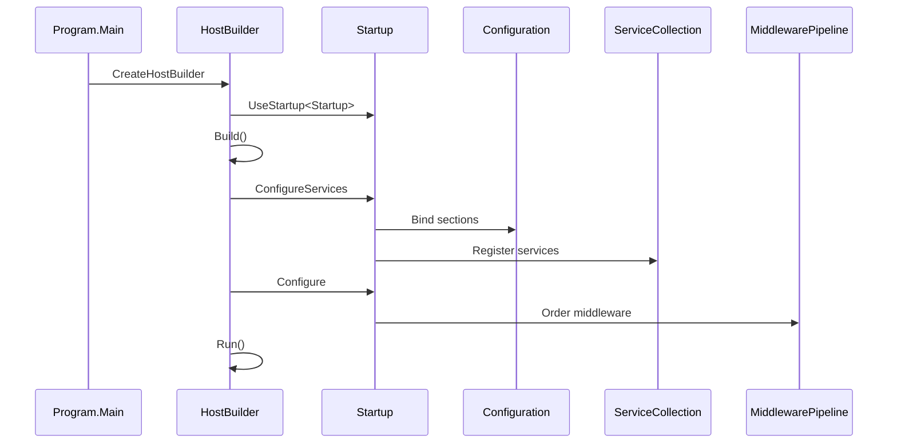

# Startup and composition

This document describes the host build, configuration binding, service registration, and middleware pipeline ordering at startup.

## Host build

`Program.CreateHostBuilder` creates a generic host with:

1. Default configuration (appsettings.json, environment variables, command line).
2. Default logging (console, debug).
3. Default dependency injection container.
4. Web host defaults pointing to `Startup`.

The host is built and run synchronously in `Main`.

## Configuration binding

`Startup.ConfigureServices` binds configuration sections:

```csharp
services.Configure<DataStoreSettings>(configuration.GetSection("dataStoreSettings"));
services.Configure<SecuritySettings>(configuration.GetSection("securitySettings"));
```

### DataStoreSettings

```csharp
public class DataStoreSettings
{
    public string WordListsRootDirectory { get; set; }
    public string GenerationSchemasPath { get; set; }
}
```

Default values from `appsettings.json`:

```json
{
  "dataStoreSettings": {
    "wordListsRootDirectory": "Data/Wordlists",
    "generationSchemasPath": "Data/GenerationSchemas.xml"
  }
}
```

### SecuritySettings

```csharp
public class SecuritySettings
{
    public string ApiKey { get; set; }
}
```

Default value from `appsettings.json`:

```json
{
  "securitySettings": {
    "apiKey": "[[UNIVERSAL_NAME_GENERATOR_API_KEY]]"
  }
}
```

The placeholder must be replaced before running.

### NuciLoggerSettings

NuciLog configuration is bound separately:

```json
{
  "nuciLoggerSettings": {
    "logFilePath": "logfile.log",
    "isFileOutputEnabled": true
  }
}
```

## Service registration

`ServiceCollectionExtensions.AddCustomServices` registers:

```csharp
public static void AddCustomServices(this IServiceCollection services)
{
    services.AddSingleton(sp => sp.GetRequiredService<IOptions<DataStoreSettings>>().Value);
    services.AddSingleton(sp => sp.GetRequiredService<IOptions<SecuritySettings>>().Value);
    services.AddScoped<INameGeneratorService, NameGeneratorService>();
    services.AddSingleton<ILogger>(sp => new NuciLogger(sp.GetRequiredService<IOptions<NuciLoggerSettings>>().Value));
}
```

| Service | Lifetime | Notes |
|---------|----------|-------|
| `DataStoreSettings` | Singleton | Unwrapped from `IOptions` |
| `SecuritySettings` | Singleton | Unwrapped from `IOptions` |
| `INameGeneratorService` | Scoped | `NameGeneratorService` per request |
| `ILogger` | Singleton | `NuciLogger` instance |

Repositories are registered by NuciDAL's assembly scanner or explicitly depending on the NuciAPI version.

## Middleware pipeline

`Startup.Configure` orders middleware:

```csharp
public void Configure(IApplicationBuilder app, IWebHostEnvironment env)
{
    app.UseNuciApiExceptionHandling();
    app.UseNuciApiScannerProtection();
    app.UseNuciApiRequestLogging();
    app.UseNuciApiCors();
    app.UseHttpsRedirection();
    app.UseStaticFiles();
    app.UseRouting();
    app.UseAuthentication();
    app.UseAuthorization();
    app.UseEndpoints(endpoints =>
    {
        endpoints.MapControllers();
    });
}
```

### Pipeline order rationale

| Order | Middleware | Purpose | Why this position |
|-------|------------|---------|-------------------|
| 1 | Exception handling | Catches all downstream exceptions | Must be first to wrap everything |
| 2 | Scanner protection | Blocks known scanner user agents | Early rejection before processing |
| 3 | Request logging | Logs incoming requests | After scanner protection, before auth |
| 4 | CORS | Adds CORS headers | Before routing for preflight |
| 5 | HTTPS redirection | Redirects HTTP to HTTPS | Standard ASP.NET Core position |
| 6 | Static files | Serves static content | Before routing |
| 7 | Routing | Matches endpoints | Required for endpoint dispatch |
| 8 | Authentication | Validates API key | Before authorization |
| 9 | Authorization | Enforces policies | After authentication |
| 10 | Endpoints | Dispatches to controllers | Last |

### NuciAPI middleware

| Middleware | Package | Function |
|------------|---------|----------|
| `UseNuciApiExceptionHandling` | `NuciAPI.Middleware.ExceptionHandling` | Translates exceptions to error envelopes |
| `UseNuciApiScannerProtection` | `NuciAPI.Middleware.ScannerProtection` | Blocks scanner user agents |
| `UseNuciApiRequestLogging` | `NuciAPI.Middleware.RequestLogging` | Structured request/response logging |
| `UseNuciApiCors` | `NuciAPI.Middleware.Cors` | CORS policy from configuration |

## IStartup for testing

`IStartup` allows integration tests to compose the same pipeline:

```csharp
public interface IStartup
{
    void ConfigureServices(IServiceCollection services);
    void Configure(IApplicationBuilder app, IWebHostEnvironment env);
}
```

`UniversalNameGeneratorApiFactory` in integration tests uses this interface to build a test host with the production pipeline.

## Startup sequence diagram



## Testing

Integration tests verify:

- Pipeline order through `NamesControllerRoutingTests`.
- Configuration binding through test factory.
- Middleware behaviour through `NamesControllerCorsTests`, `NamesControllerExceptionHandlingTests`.

See [Testing](../testing.md).